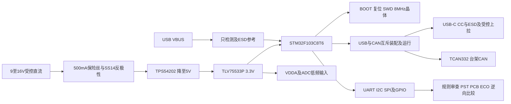

# D和E合并课程 第15至26课完整学习记录

2026-10-19，Asia/Shanghai。按用户要求，以一套 **STM32F103C8T6控制板**串联工程需求、MCU基础、电源、接口、保护和网表/ECO。第15—25课的资料研读、计算、约束和原生连接练习已完成；第26课的真实PST导出、PCB导入、ECO及逆向比较已通过。**Capture GUI完整ERC、GUI应用SWP和实板测量仍待验，第26课不标为无条件完成。**

最终是单页六模块的教学原理图，80件、272个物理引脚、69个网络；266个连接成员与6个明确NC逐一核对。原生BRD含全部逻辑元件，尚未放置、布线。它是可持续练习的工程基线，没有按制造或硬件功能释放。

## 合并后的学习路线

保留15—26课号，按电路关系合并学习，不把“合并课程”当作减少验收内容。用户早前暂停的51编程教程仍未学习；本次依据新指令开展的是MCU硬件电路及Cadence工程工作。

## 当前工程与记录入口

| 产物 | 当前文件和用途 |
| --- | --- |
| 原生基线工程 | [DE_CONTROL.opj](../examples/de_15_26_20261019/native/DE_CONTROL.opj)、[de_integrated_single.dsn](../examples/de_15_26_20261019/native/de_integrated_single.dsn)；I2C上拉2.2k，优先继续使用此版 |
| 原生ECO工程 | [DE_CONTROL_ECO.opj](../examples/de_15_26_20261019/native/DE_CONTROL_ECO.opj)、[de_integrated_eco_final.dsn](../examples/de_15_26_20261019/native/de_integrated_eco_final.dsn)；两处数值及两处接口连接变更 |
| 原生符号和物理依赖 | [library](../examples/de_15_26_20261019/library)：de_training_single.olb；准备/验证19种PSM，实际电路使用18种，含必要PAD/DRA |
| 真实导入PCB | [DE_BASELINE.brd](../examples/de_15_26_20261019/native_flow_final/DE_BASELINE.brd)、[DE_ECO.brd](../examples/de_15_26_20261019/native_flow_final/DE_ECO.brd)；只完成逻辑导入和ECO，放置symbol为0 |
| 当前BOM | [基线BOM](../examples/de_15_26_20261019/BOM_baseline.csv)、[ECO BOM](../examples/de_15_26_20261019/BOM_eco.csv)；保留数值、完整规格、MPN状态、封装、装配和要求 |
| 结构化电路 | [基线规格](../examples/de_15_26_20261019/integrated_circuit.json)、[ECO规格](../examples/de_15_26_20261019/integrated_circuit_eco.json)、[项目约束](../examples/de_15_26_20261019/project_constraints.json) |
| MCU原厂依据和计算 | [第15—19课完整记录](lessonDE_mcu_15_19_20261019.md)，含48脚用途表和逐项来源 |
| 电源与接口依据和计算 | [第20—25课完整记录](lessonDE_power_interfaces_20_25_20261019.md)，含52件子网、选型与拒选理由 |
| 第26课真实后端 | [完整记录](lesson26_native_backend_20261019.md)，含命令、失败、PST/BRD/VIEW/SWP和待验边界 |
| 统一验收与文件身份 | [交付清单](../logs/de_15_26_20261019/deliverable_manifest.json)；版本、哈希、链接、原生及独立审查结果 |

OPJ按官方工程语法生成并检查资源路径，GUI打开没有验收。DSN/OLB和BRD确实由Cadence原生数据库保存并在独立进程重开；CSV/JSON是辅助证据。矩形符号体是显式引脚的教学模型，图形制图质量不能由连通通过代替；原始模块名保存为SOURCE_MODULE_PAGE，笔记和BOM按六模块分类。

## 第15课需求和约束

下面的输入电压、环境、负载、速率和接口边界是本次**自行确定的教学假设**，不是用户给定的产品规格。来源器件限制与这些设计假设分别记录。

| 编号 | 当前约束 | 依据或验收方法 |
| --- | --- | --- |
| R15-01 | MCU为STM32F103C8T6，LQFP48，保证Flash64KB、SRAM20KB；不增加不存在的VCAP/VREF脚或EP | ST DS5319 Rev20、48脚原生读回及B9实封装 |
| R15-02 | 外部受控限流台源9—16V，先5V再3.3V；不是汽车/长线浪涌输入 | TPS54202/TLV755P/SS14资料；电源入口和拒选TVS记录 |
| R15-03 | 正常V3V3总电流预算150mA，环境0—40℃；GPIO与全部header外载合计≤10mA | 最终电流分配与热计算；实板验证待续 |
| R15-04 | USB为自供电USB2 Full Speed设备；VBUS只检测/ESD参考，不接板上V5/V3V3；台架检测算例VBUS≥4.75V | USB-C/USBLC6及N-MOS隔离拓扑；未声称全部USB电压/合规工况通过 |
| R15-05 | USB与CAN使用互斥装配和运行模式，PA11/PA12共用；不能通过重映射消除共享SRAM冲突 | ST AN4879/RM0008及两个装配profile |
| R15-06 | CAN短台架≤1m、≤500kbps；120Ω只在物理总线两端；不覆盖汽车故障和长线工业浪涌 | TCAN332原厂条件，终端/故障范围另列 |
| R15-07 | UART/I2C/SPI/GPIO为3.3V台架接口；无外部反供、无热插拔承诺 | 原厂I/O限制、原生接线与接口约束 |
| R15-08 | I2C教学默认100kHz、总电容≤100pF；400kHz只作条件性RC预算，启用前核时序与实板 | ST同版表/脚注有不一致，见MCU记录；基线2.2k、ECO3.3k |
| R15-09 | SPI≤1MHz、短互连≤10cm；串阻33Ω为源端调试起点 | 按实际边沿/接收端/互连重核，不能用频率单独证明无串扰 |
| R15-10 | ADC0为0—3.0V、≤1Hz受控源，源阻≤1kΩ、板上1k+100nF、100S/s；板必须有电 | DS5319/AN2834采样与RC计算；不是100S/s抗混叠认证 |
| R15-11 | USB连接器必须按B10板边/开口/孔/装配边界使用；MCU高1.6mm、电感高6.1mm；电解高11mm只是待选料采购包络 | 原厂图、原生封装及B9/B10；外壳与最终板框尚未定义 |
| R15-12 | 当前承载板只有TOP和BOTTOM；生产厚度、材料、阻抗和层叠待第28课定义 | 原生Cross Section读回：TOP/未命名介质/BOTTOM；固定层名规范继续遵守 |

电流预算修正：最初120mA没有覆盖所有正常最坏情形。DS5319表13的MCU50mA基数有72MHz、指定Flash代码、全外设、85℃characterization且I/O无负载等前提；TCAN332正常重载最大60mA，加外载10mA已达120mA，两根2.2k上拉最坏约3.182mA以及其他支路还需额外预算。因此最终改为150mA并留支路余量。CAN bus-fault的180mA属于故障条件，不能塞入正常预算后声称热设计合格。

按V5静态计算最大5.14599V、V3V3最小3.2505V、150mA和JEDEC RθJA=231.1℃/W，LDO耗散约0.284W、温升约65.7℃，40℃环境估算结温约105.7℃。这只是指定条件下的预算；实际铜、风速、容差和瞬态仍要实板测量，不能把JEDEC数直接当作本PCB实测热阻。旧原生L1要求中“covers nominal120mA”保留为构建时历史描述，电感真实额定和本节最终150mA项目预算分别核对，不据该旧文字限制或保证当前负载。

## 第16至25课完成内容

| 课号 | 学到并实际落实的内容 | 证据范围 |
| --- | --- | --- |
| 16 | VDD24/36/48各100nF、VDD3有效≥4.7µF bulk、VBAT1直连3.3V及100nF、VDDA9经0Ω和10nF/100nF/有效≥1µF，所有地到连续GND | 48脚原厂表、原生网表和局部回流意图；真实电源完整性/去耦放置待PCB |
| 17 | NRST10k/100nF及复位shunt、BOOT0/1下拉与服务跳线、1×6本地SWD含VTREF/NRST/SWO；区分USART1 ROM boot与USB DFU | 原生连接和启动条件；未声称实际下载/启动通过；该接口不是标准ARM10pin |
| 18 | ABM3B-8.000MHZ-D2Y-T、CL/ESR/C0/drive、16pF初值、gm裕量计算；HSE8MHz→PLL72MHz/USB48MHz、ADC12MHz | 原厂来源/计算及1/3谐振、2/4接地原生映射；启动/频偏/drive实测待续 |
| 19 | PA0 ADC0、1k+100nF、源阻与采样时间、71.5cycle/12MHz、校准和误差预算、VDDA作为LQFP48参考 | 原生RC连接、约5.958µs采样与约1.94ms外RC阶跃收敛计算；低频受控输入条件 |
| 20 | TLV75533P引脚、EN/NC、有效电容要求、150mA热预算和反向供电限制 | 原厂稳定性要求、完整规格BOM、原生供电连接；掉电反灌/实板热待测 |
| 21 | TPS54202 pin5允许悬空使能、BOOT100nF到SW、15µH XAL6060、2×22µF输出、100k/13.5k0.1%与75pF Cff起点 | 原生连接、参考容差计算、真实电感land和额定；负载阶跃/环路/纹波/故障未实测 |
| 22 | 开关电流热回路、LC谐振/阻尼及元件非理想性；VDDA默认0Ω，不套用未评估磁珠；输入bulk与源阻抗单列 | 真实LC电路与对比分析；需要按最终电容偏压曲线和布线复核，未声称任意滤波器稳定 |
| 23 | USB4105接点与12land映射、两CC各5.1k、成对DP/DM、USBLC6内部等价pin、22Ω、VBUS隔离检测及受控D+上拉 | 原厂图与原生逐脚对应；USB枚举、波形与合规测试待实板 |
| 24 | UART/SPI源端串阻、I2C上拉区间/上升时间、CAN NC5/8及TXD默认recessive、终端和互斥模式 | 原生网络、装配属性重读；CAN时序/通信和I2C400k运行未实测 |
| 25 | F1/SS14反极性、TVS耐压/钳位拒选、USB局部ESD返回、CAN故障包络、掉电注入与外部反供约束 | 保护选择和实际拓扑；器件级ESD额定不等于整板合规，未认证浪涌/ESD |

去耦回路、晶振、ADC电容回流、USB保护和buck热回路已经形成布局约束；原理图上同属GND不等于任意路径都合格。下一阶段要在真实器件位置、铜、过孔和参考平面上落实。未布线的BRD不能用DRC=0替代SI/PI/EMI审查。

## 第26课与ECO验收

真正执行的路径为：官方Capture数据库保存DSN → pstswp原生三文件 → netrev读取且把缺封装视为错误 → 全新Allegro只读获取所有逻辑元件/针/网 → 修改原DSN副本 → 重导PST/更新BRD → BRD四VIEW → SWP比较。没有用Python生成的网表代替Cadence导出。

| 比较 | 结果 |
| --- | --- |
| DSN物理pin/电气类型/NC/属性及网络与规格 | [1519项原生读回与自定义规则](../logs/de_15_26_20261019/native_acceptance.json)通过；明确不是GUI ERC |
| MCU原厂表及关键拓扑独立审查 | [53项](../logs/de_15_26_20261019/mcu_native_review.json)通过，包含装配属性和完整位号 |
| 电源/接口独立原厂审查 | [1577项](../logs/de_15_26_20261019/power_native_review.json)通过；52件每版146个物理pin及规格/BOM |
| 物理封装依赖 | [717项](../examples/de_15_26_20261019/dependency_validation.json)通过；准备库19种PSM均隔离装载、保存、新进程重开，其中18种用于电路，SMB为未用TVS候选 |
| 需求规格→原生PST→BRD→ECO | [1578项](../examples/de_15_26_20261019/native_flow_final/independent_compare.json)通过；两个原始DSN导出前后SHA不变 |
| 逆向VIEW/SWP | [SWP](../examples/de_15_26_20261019/native_flow_final/feedback/DE_ECO.swp)只有Flags/DesignName，无非预期改名/交换/属性差异；GUI应用仍待验 |

这些检查有重叠，不相加成一个“总测试数”。它们分别验证来源、原生连接、库依赖及跨工具数据一致性。四个故意错误只注入**读回表副本**用于检查自定义规则能发现问题，不是在用户工程中植入故障，也不是Capture GUI ERC的结果。

本次ECO只有：R19/R20由2.2k改3.3k；J13.7和J13.8的PB8/PB9对调，MCU45/46不动。未增删元件，其他连接保持。ECO电阻完整源规格也修正为3.3k1%，并重新完成最终后端链。3.3k+1%/100pF的计算上升时间约282.4ns，400kHz的300ns预算余量小；这只是受控变更练习，新增线缆/探头电容必须重算，基线2.2k保留较大余量。

装配信息是明确的BOM/原生属性策略，不是已执行硬件装配：默认USB装R5/R6的22Ω，R12/R13的CAN0Ω为DNP；CAN模式反转，且固件USB/CAN互斥。PST/BRD保留全部备选器件的焊盘与逻辑元件，不能从“网表含DNP电阻”推断它已焊接。

## 失败、修正和当前边界

1. 本地RAR/STM32F103C8T6.pdf实际是一页旧工程图，不能当ST数据手册。改用有版本和页码的DS5319及应用笔记；旧图只作历史对比。
2. 原生六页设计虽然页面/元件/导线几何均存盘，但Expand返回ORDBDLL-1021，PST包装只产生部分连接并报错。即使下游netrev能够生成板也不能验收。最后改用单页80件，完整266连接和跨工具比较全部通过；六页SDK问题留待专门研究。
3. NewPlacedInst第一个名称改为真实LibPart名，MarkAllLibForSave及逐页保存不能单独解决上述多页问题；不把尝试过的修正写成根因。
4. 单页副本最初NextPage非NULL但状态3969；先GetRootOccurrence再迭代页面后状态为0。保存后的ECO值/连接另起进程验证。
5. 最初BOM只导出数值而丢掉部分容差/耐压。现在保留Specification、Procurement_Status及完整原生来源属性；ECO数值与描述已对齐，重复拼接已修正。未选MPN的无源/接口明确标SPEC_ONLY，不伪造采购料号。
6. 原生依赖初版SKILL少闭合括号导致退出异常，失败源/mini-dump已隔离，之后批次均正常结束。逆向SWP有缺cdsz后回退四DAT的stderr，完成比较仍exit0，记录未删除。
7. 已读的原厂在线资料和成功离线归档分别登记；ST部分应用笔记shell下载超时，没有冒称本地PDF存在。本次没有把72讲下载视频记作已观看，也没有学习51固件教程。

仍待实际验收：Capture GUI ERC/OPJ视觉制图与命令窗、GUI应用SWP、全部器件最终MPN/偏压曲线/推荐land认证、USB/ADC/时钟/复位与启动调试、buck稳定/纹波/短路、LDO热/反灌、ESD/浪涌、生产层叠及PCB布局布线。各项与已完成的理论/CAD范围分开记录。

## 继续工作入口

先读本记录，再按需要进入MCU、电源接口或第26课详细笔记。读取权威基线时同时保留原生库与library路径；不要把失败六页版本或历史native_flow当作最终工程。源文件改变后必须重新原生读回并校验哈希，单独重跑旧日志比较不能重新证明当前CAD正确。

下一主线进入第27课板框和机械基准，再第28课生产层叠及第29课约束。当前TOP/BOTTOM只是逻辑承载板层名，不代表最终层叠已选。后续层名严格延伸TOP-L2-…-BOTTOM；位号/Value三文字锚点(0,0)及真实器件高度覆盖默认1mm的规范继续执行。GUI待验项并行保留，不在新课中抹去。
